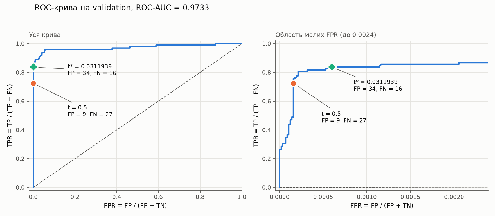
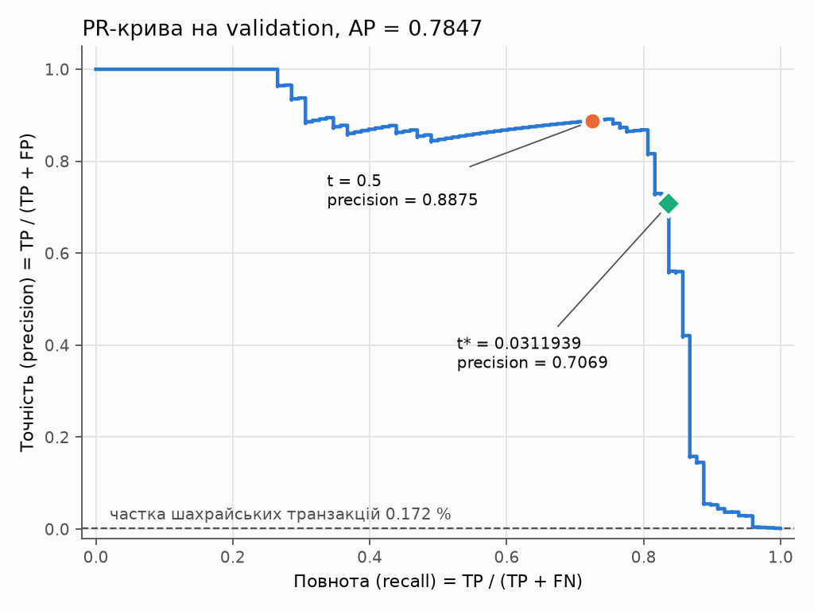

# ЛР2. Поріг рішення під асиметричну ціну помилок

Виконав: Медар Кирило, група КМ-31.

У роботі обчислено TP, FP, FN, TN і вартість помилок, знайдено поріг із мінімальною
вартістю на validation, перевірено пошук прямим перебором на трьох малих наборах і
застосовано зафіксований поріг до test. Модель задано умовою; її навчено один раз
стартовим кодом викладача.

Результат: поріг t\* ≈ 0.0311939, вибраний на validation, дає вартість помилок 194 на
validation (за порога 0.5 вона дорівнює 279) і 233 на test (за порога 0.5 вона дорівнює 288).

## Запуск

Потрібні Python 3.12 та [uv](https://docs.astral.sh/uv/). Версії залежностей зафіксовано
в `pyproject.toml` і `uv.lock`.

```bash
uv sync

# 1. Навчання з локального CSV. Стартовий код не запускає навчання, якщо тека --out
#    непорожня; results/ уже є в репозиторії, тому результати повторного навчання
#    записуються в іншу теку.
uv run python lab2_starter.py --data /шлях/до/creditcard.csv --out results_rerun

# 2. Аналіз зі збережених прогнозів, без навчання й без CSV (пункти 2–4 умови).
uv run python analysis.py --saved results --out outputs
```

Додаткові команди:

```bash
uv run python checks.py                             # перевірка на наборах A, B, C
uv run python compare_runs.py results results_rerun # порівняння поділу і статистик стандартизації
```

Дані: [Credit Card Fraud Detection](https://www.kaggle.com/datasets/mlg-ulb/creditcardfraud),
файл `creditcard.csv` (150 828 752 байти, 284 807 транзакцій). До репозиторію файл не
додано; шлях до локальної копії передається параметром `--data`. SHA-256 файла, на якому
навчено модель: `76274b691b16a6c49d3f159c883398e03ccd6d1ee12d9d8ee38f4b4b98551a89`.

## Склад теки

| Шлях | Зміст |
|---|---|
| `lab2_starter.py` | стартовий код викладача без змін: поділ, стандартизація, навчання, збереження |
| `threshold.py` | лічильники TP, FP, FN, TN, вартість, таблиця кандидатів, вибір порога |
| `checks.py` | незалежний прямий перебір на наборах A, B, C |
| `analysis.py` | криві, пошук порога, перевірки, тестова оцінка, таблиця помилок |
| `compare_runs.py` | порівняння повторного навчання зі збереженим запуском |
| `results/` | `model.pt`, `predictions.npz` (індекси поділу, мітки, Amount, оцінки), `preprocessing.npz`, `run.json`, `split_summary.csv` |
| `outputs/roc_validation.png`, `outputs/pr_validation.png` | ROC- і PR-криві на validation |
| `outputs/candidates_validation.csv` | повна таблиця кандидатів, 55 980 рядків, без округлення |
| `outputs/threshold.json` | зафіксований поріг |
| `outputs/validation_comparison.csv` | пороги 0.5, t\* і +∞ на validation |
| `outputs/check_A.csv`, `check_B.csv`, `check_C.csv`, `checks_summary.csv` | результати трьох перевірок |
| `outputs/test_metrics.json`, `outputs/test_comparison.csv` | тестова оцінка |
| `outputs/test_errors.csv` | таблиця розібраних помилок |
| `outputs/report.md` | таблиці validation, перевірок і test, згенеровані кодом |

## Відтворюваність

- **Аналіз.** Команда `uv run python analysis.py --saved results --out outputs` відтворює
  числа цього README: поріг, лічильники, вартість, таблицю помилок. Повторний запуск на тій
  самій машині створює файли, що побайтно збігаються з наявними в `outputs/`. На іншій
  платформі можуть відрізнятися файли зображень.
- **Навчання.** Повторне навчання дає той самий поділ і ті самі статистики стандартизації.
  Скрипт `compare_runs.py` перевіряє точний збіг індексів, міток і `Amount`. Для `mean`,
  `scale`, `var` також перевіряється точний збіг, а за розбіжності в молодших розрядах
  float64 застосовується допуск 1e-12. Для оцінок виводиться найбільша абсолютна різниця:
  на іншій платформі чи за іншої версії PyTorch оцінки можуть відрізнятися в молодших
  розрядах. На машині, де навчено модель, повторний запуск дав різницю 0.
- **Середовище.** Linux x86_64, Python 3.12.3, NumPy 2.5.3, pandas 3.0.6,
  scikit-learn 1.9.1, PyTorch 2.14.1 на CPU, 2 потоки. Версії бібліотек записано також у
  `results/run.json`.
- **CSV.** У `candidates_validation.csv` пороги записано без округлення. Для точного
  зчитування в pandas потрібен параметр `float_precision="round_trip"`. `analysis.py` цей
  файл не зчитує.

## Джерела та інструменти

- Умова роботи «ЛР2 завдання.pdf» і стартовий код викладача `lab2_starter.py` (використано
  без змін).
- Лекція 2 курсу: поріг класифікації, матриця плутанини, ROC- і PR-криві, вибір робочої
  точки, теоретичний орієнтир 1/11.
- Документація scikit-learn: `roc_curve`, `roc_auc_score`, `precision_recall_curve`,
  `average_precision_score` (використано для побудови кривих і обчислення ROC-AUC та AP).
- Генеративний інструмент Claude (Anthropic): підготовка коду `threshold.py`, `checks.py`,
  `analysis.py`, `compare_runs.py`, запуск навчання й аналізу, складання цього звіту.

## Позначення і формули

Позитивний клас: шахрайські транзакції (мітка 1). Негативний клас: легітимні транзакції
(мітка 0). Оцінку моделі позначено s, поріг позначено t.

Правило рішення:

```math
\hat y_i(t) = \mathbb{1}[s_i \ge t]
```

Лічильники матриці плутанини:

```math
TP(t)=\sum_i \mathbb{1}[s_i\ge t] \cdot \mathbb{1}[y_i=1],\qquad FP(t)=\sum_i \mathbb{1}[s_i\ge t] \cdot \mathbb{1}[y_i=0]
```

```math
FN(t)=\sum_i \mathbb{1}[s_i< t] \cdot \mathbb{1}[y_i=1],\qquad TN(t)=\sum_i \mathbb{1}[s_i< t] \cdot \mathbb{1}[y_i=0]
```

FN дорівнює кількості пропущених шахрайств, FP дорівнює кількості хибних тривог.
Вартість помилок:

```math
C(t) = 10 \cdot FN(t) + FP(t)
```

`Amount` у вартість не входить. Точність (precision), повнота (recall, TPR) і частка хибно
позитивних (FPR):

```math
\mathrm{precision}=\frac{TP}{TP+FP},\qquad \mathrm{recall}=TPR=\frac{TP}{TP+FN},\qquad FPR=\frac{FP}{FP+TN}
```

Реалізація: `threshold.py`, функції `confusion_counts` (пряме застосування правила для
одного порога), `cost`, `precision`, `recall`.

## 1. Навчання та збереження прогнозів

Вхід моделі: 29 ознак, `V1`–`V28` і `Amount`. `Class` і `Time` на вхід не подаються.
Сире значення `Amount` збережено окремо в `predictions.npz` для аналізу помилок.

Поділ 60/20/20 стратифікований і виконується для індексів рядків CSV:
`train_test_split(test_size=0.4, stratify=Class, random_state=0)`, потім відкладена частина
ділиться навпіл із `test_size=0.5`, стратифікацією за її мітками та `random_state=0`.
Першу половину використано як validation, другу як test. Класи не балансуються.

| Частина | Об'єктів | Шахрайських транзакцій | Частка |
|---|---|---|---|
| train | 170 884 | 295 | 0.1726 % |
| validation | 56 961 | 98 | 0.1720 % |
| test | 56 962 | 99 | 0.1738 % |
| разом | 284 807 | 492 | 0.1727 % |

Модель: `Linear(29,32) → ReLU → Linear(32,1)`. Функція втрат: `BCEWithLogitsLoss` без
зважування класів. Оптимізатор: Adam зі швидкістю навчання 0.001. Навчання: 12 епох,
пакет 1024, CPU, float32. Використано ваги після 12-ї епохи; епоха за validation не
вибиралась. Оцінки s = sigmoid(z), де z позначає вихідний логіт, збережено у float32 без
округлення.

**Чому статистики стандартизації не можна обчислювати на всьому наборі.** Середнє і
стандартне відхилення ознак оцінюються за даними і є параметрами перетворення. Якщо
обчислити їх на всіх 284 807 рядках, до входу моделі потрапить інформація про validation
і test (витік даних). Тоді validation не буде незалежною вибіркою для вибору порога, а
оцінка вартості на test може бути оптимістично зміщеною. Крім того, транзакції, до яких
модель застосовуватиметься, на етапі навчання недоступні. Тому статистики обчислюються
на train і застосовуються до validation, test і нових даних. У стартовому коді це
реалізовано викликом `StandardScaler().fit(x[idx_tr])`.

## 2. Вибір порога на валідаційній вибірці

### 2.1. Криві та ROC-AUC





ROC-AUC = 0.9733, середня точність AP = 0.7847. Криві побудовано функціями scikit-learn;
точки для порогів 0.5 і t\* нанесено за лічильниками, обчисленими в `threshold.py`.

**Чому висока ROC-AUC не гарантує малої вартості помилок чи високої точності.**

1. ROC-AUC характеризує якість ранжування за всіма порогами: це ймовірність того, що
   випадково вибрана шахрайська транзакція має вищу оцінку, ніж випадково вибрана
   легітимна (пари з рівними оцінками враховуються з вагою 1/2). Показник не залежить від
   вибору порога і не враховує ціни помилок. За того самого значення ROC-AUC вартість
   дорівнює 279 за порога 0.5 і 194 за порога t\*.
2. FPR і точність мають різні знаменники: у FPR це всі 56 863 негативні приклади, у
   точності це кількість позитивних рішень TP + FP. За порога t\* FPR = 34 / 56 863 ≈ 0.0006,
   але ті самі 34 хибні тривоги становлять 29 % зі 116 позитивних рішень, тому точність
   дорівнює 0.707. Зв'язок через частку позитивного класу π (на validation 0.172 %):

   ```math
   \mathrm{precision}=\frac{\pi \cdot TPR}{\pi \cdot TPR+(1-\pi) \cdot FPR}
   ```

   За малого π мала FPR може відповідати кількості хибних тривог, порівнянній із кількістю
   істинно позитивних.
3. ROC-AUC дорівнює площі під кривою на всьому відрізку FPR від 0 до 1, а пороги з
   вартістю, не більшою за 203, відповідають FPR, меншій за 0.001 (права панель рисунка
   ROC охоплює FPR до 0.0024). Точка з високою TPR може мати велику вартість: TPR = 0.959
   (94 із 98) досягається за порога 0.00243, якому відповідають 3171 хибна тривога,
   точність 0.029 і вартість 3211, що в 16.6 раза перевищує мінімальну.
4. Мінімальна вартість 194 = 10 · 16 + 34: 16 шахрайських транзакцій мають оцінки, нижчі
   за t\*. Для виявлення 95 із 98 шахрайських транзакцій потрібен поріг, якому
   відповідають 21 492 хибні тривоги, для 96 із 98 потрібно 26 350, для всіх 98 потрібно
   49 641.

### 2.2. Пошук порога

**Кандидати.** Усі унікальні оцінки validation та +∞. У validation 56 961 оцінка,
унікальних значень серед них 55 979, тому кандидатів 55 980. Ці кандидати охоплюють усі
різні варіанти рішень на вибірці: рішення змінюються тільки тоді, коли поріг перетинає
значення оцінки. Поріг між двома сусідніми унікальними оцінками дає ті самі рішення, що
й більша з них; поріг, більший за найбільшу оцінку, дає ті самі рішення, що й +∞; поріг,
не більший за найменшу оцінку, дає ті самі рішення, що й найменша оцінка.

**Алгоритм** (`candidate_table` у `threshold.py`):

1. Сортування прикладів за спаданням оцінки: O(n log n).
2. Кумулятивні суми індикаторів позитивної та негативної мітки, що дорівнюють кількостям
   позитивних і негативних міток серед перших k прикладів: O(n).
3. Визначення останньої позиції кожної групи рівних оцінок (група може складатися з
   одного прикладу): O(n).
4. Для кандидата t позитивне рішення за правилом s ≥ t отримують приклади до кінця групи
   з оцінкою t включно. Тому TP(t) і FP(t) дорівнюють кумулятивним сумам у цій позиції,
   FN = P − TP, TN = N − FP, де P і N позначають кількості позитивних і негативних міток.
5. Для +∞ позитивних рішень немає: TP = FP = 0, FN = P, TN = N.
6. Обчислення вартості для всіх кандидатів і вибір мінімуму: O(n).

Загальна складність O(n log n) визначається сортуванням. Повторного проходу по вибірці
для кожного порога немає.

**Рівні оцінки.** Кумулятивні суми зчитуються тільки в кінці групи, тому всі приклади з
однаковою оцінкою отримують однакове рішення, і кандидата всередині групи немає.
У validation 724 групи з двох і більше рівних оцінок; вони містять 1706 прикладів,
найбільша група має 16 прикладів.

**Граничні пороги.** Перший рядок таблиці, +∞, відповідає правилу «усі негативні»:
FN = 98, вартість 980. Останній рядок, найменша оцінка (на validation вона дорівнює 0.0),
відповідає правилу «усі позитивні»: FP = 56 863, вартість 56 863.

**Кілька мінімумів.** Якщо мінімальну вартість мають кілька порогів, вибирається
найбільший із них (`select_threshold`). На validation мінімум єдиний: вартість 194 має
тільки t\*; наступне за величиною значення вартості, 195, відповідає порогу 0.0306.
Правило вибору перевіряється на наборі C (розділ 3).

### 2.3. Результат

t\* = 0.031193900853395462 (значення float32-оцінки, перетворене у float64 без втрати
точності; у `threshold.json` наведено також шістнадцятковий запис).

| Правило на validation | Поріг | TP | FP | FN | TN | C | precision | recall |
|---|---|---|---|---|---|---|---|---|
| Стандартний поріг | 0.5 | 71 | 9 | 27 | 56 854 | 279 | 0.8875 | 0.7245 |
| Мінімум вартості | t\* ≈ 0.0311939 | 82 | 34 | 16 | 56 829 | 194 | 0.7069 | 0.8367 |
| Усі негативні | +∞ | 0 | 0 | 98 | 56 863 | 980 | не визначена | 0.0000 |

Рядки для 0.5, t\* і +∞ обчислено прямим застосуванням правила (`confusion_counts`).
`analysis.py` перевіряє їхній збіг із відповідними рядками таблиці кандидатів. Значення
0.5 серед кандидатів немає; йому відповідає найменший кандидат, не менший за 0.5.

Додатково:

- Вартість є кусково-сталою функцією порога. У діапазоні порогів від 0.0293 до 0.0454
  розташовано 25 кандидатів із вартістю від 194 до 210, тому зсув порога в цих межах
  змінює вартість не більш як на 16. Найближчий більший кандидат, 0.031203, має вартість
  204; найближчий менший, 0.030646, має вартість 195.
- Теоретичний орієнтир із лекції 2, 1/11 ≈ 0.0909, дає на validation вартість 203 (TP = 79,
  FP = 13, FN = 19). Відмінність t\* від 1/11 сама по собі не доводить некаліброваності
  оцінок: на скінченній вибірці вартість кусково-стала, а позитивних прикладів 98.

## 3. Перевірка реалізації пошуку порога

Перевірка в `checks.py` не залежить від навченої моделі та від алгоритму з кумулятивними
сумами. Список кандидатів будується через `set`, лічильники обчислюються вкладеним циклом
за правилом s ≥ t для кожного кандидата, поріг вибирається окремим циклом. Алгоритм із
кумулятивними сумами викликається після прямого перебору і тільки для порівняння.
Очікувані пороги й вартості додатково обчислено вручну (значення записано в `EXPECTED`).

Порівнюються всі рядки: список кандидатів, TP, FP, FN, TN і C мають збігатися точно, а
вибраний поріг має відповідати тому самому правилу вибору серед кількох мінімумів.
`analysis.py` не застосовує поріг до test, якщо хоча б одну перевірку не пройдено.

### Набір A

Оцінки: 0.9, 0.7, 0.7, 0.4, 0.2, 0.1. Мітки: 0, 1, 0, 1, 0, 0. P = 2, N = 4.

| Поріг | TP | FP | FN | TN | C (прямий перебір) | C (кумулятивні суми) | Лічильники збігаються |
|---|---|---|---|---|---|---|---|
| +∞ | 0 | 0 | 2 | 4 | 20 | 20 | так |
| 0.9 | 0 | 1 | 2 | 3 | 21 | 21 | так |
| 0.7 | 1 | 2 | 1 | 2 | 12 | 12 | так |
| 0.4 | 2 | 2 | 0 | 2 | 2 | 2 | так |
| 0.2 | 2 | 3 | 0 | 1 | 3 | 3 | так |
| 0.1 | 2 | 4 | 0 | 0 | 4 | 4 | так |

Мінімум C = 2 за порога 0.4 (FN = 0, FP = 2). Прямий перебір, алгоритм із кумулятивними
сумами і ручний розрахунок дають t\* = 0.4.

**Що перевіряє набір A.** Набір A перевіряє обробку рівних оцінок із різними мітками.
Правильна таблиця містить один рядок для 0.7, у якому позитивне рішення отримують обидва
приклади (FN = 1, FP = 2, C = 12). Реалізація, що зчитує кумулятивні суми після кожного
прикладу, а не в кінці групи, утворила б зайвий рядок: TP = 1, FP = 1, C = 11 або TP = 0,
FP = 2, C = 22, залежно від порядку в групі. Вибраний поріг у такому разі залишився б
0.4, тому порівнюються всі лічильники, а не тільки вибраний поріг.

### Набір B

Оцінки: 0.9, 0.6, 0.3. Мітки: 0, 0, 0. P = 0, N = 3.

| Поріг | TP | FP | FN | TN | C (прямий перебір) | C (кумулятивні суми) | Лічильники збігаються |
|---|---|---|---|---|---|---|---|
| +∞ | 0 | 0 | 0 | 3 | 0 | 0 | так |
| 0.9 | 0 | 1 | 0 | 2 | 1 | 1 | так |
| 0.6 | 0 | 2 | 0 | 1 | 2 | 2 | так |
| 0.3 | 0 | 3 | 0 | 0 | 3 | 3 | так |

P = 0, тому FN = 0 за будь-якого порога і C = FP. Мінімум C = 0 за порога +∞. Прямий
перебір, алгоритм із кумулятивними сумами і ручний розрахунок дають t\* = +∞.

**Що перевіряє набір B.** Набір B перевіряє пошук за відсутності позитивних міток і вибір
граничного порога +∞. Мінімум досягається тільки на кандидаті +∞; реалізація без цього
кандидата повернула б 0.9 з C = 1. Повнота для цього набору не визначена за будь-якого
порога, оскільки TP + FN = 0.

### Набір C

Оцінки: 0.8; одинадцять оцінок 0.5; 0.2. Мітки: для 0.8 мітка 1; серед одинадцяти оцінок
0.5 перша має мітку 1, решта десять мають мітку 0; для 0.2 мітка 0. P = 2, N = 11.

| Поріг | TP | FP | FN | TN | C (прямий перебір) | C (кумулятивні суми) | Лічильники збігаються |
|---|---|---|---|---|---|---|---|
| +∞ | 0 | 0 | 2 | 11 | 20 | 20 | так |
| 0.8 | 1 | 0 | 1 | 11 | 10 | 10 | так |
| 0.5 | 2 | 10 | 0 | 1 | 10 | 10 | так |
| 0.2 | 2 | 11 | 0 | 0 | 11 | 11 | так |

Мінімум C = 10 мають пороги 0.8 (FN = 1, FP = 0) і 0.5 (FN = 0, FP = 10); вибирається
більший. Прямий перебір, алгоритм із кумулятивними сумами і ручний розрахунок дають
t\* = 0.8.

**Що перевіряє набір C.** Набір C перевіряє вибір серед кількох порогів з однаковою
мінімальною вартістю: одне пропущене шахрайство або десять хибних тривог. Реалізація, що
повертає останній знайдений мінімум або найменший поріг, дала б 0.5. Група з одинадцяти
рівних оцінок із різними мітками додатково перевіряє обробку рівних оцінок.

### Підсумок перевірок

| Набір | t\* (прямий перебір) | C (прямий перебір) | t\* (кумулятивні суми) | C (кумулятивні суми) | Лічильники збігаються | Поріг збігається | Збіг із ручним розрахунком |
|---|---|---|---|---|---|---|---|
| A | 0.4 | 2 | 0.4 | 2 | так | так | так |
| B | +∞ | 0 | +∞ | 0 | так | так | так |
| C | 0.8 | 10 | 0.8 | 10 | так | так | так |

Усі три перевірки пройдено. Після цього поріг зафіксовано й застосовано до test.

## 4. Тестова оцінка та аналіз помилок

Зафіксований поріг t\* ≈ 0.0311939 застосовано до test (56 962 об'єкти, 99 шахрайських
транзакцій).

Матриця плутанини:

| | Рішення: шахрайська | Рішення: легітимна |
|---|---|---|
| **Мітка: шахрайська** | TP = 80 | FN = 19 |
| **Мітка: легітимна** | FP = 43 | TN = 56 820 |

```math
C = 10 \cdot 19 + 43 = 233,\qquad \mathrm{precision} = \frac{80}{80+43} = 0.6504,\qquad \mathrm{recall} = \frac{80}{80+19} = 0.8081
```

Для порівняння наведено лічильники на test для правил із таблиці розділу 2.3. За
результатами test поріг, модель і налаштування навчання не змінювались.

| Правило на test | Поріг | TP | FP | FN | TN | C | precision | recall |
|---|---|---|---|---|---|---|---|---|
| Зафіксований t\* | 0.0311939 | 80 | 43 | 19 | 56 820 | 233 | 0.6504 | 0.8081 |
| Стандартний поріг | 0.5 | 71 | 8 | 28 | 56 855 | 288 | 0.8987 | 0.7172 |
| Усі негативні | +∞ | 0 | 0 | 99 | 56 863 | 990 | не визначена | 0.0000 |

**Нульовий знаменник.** Якщо знаменник дорівнює нулю, вираз має вигляд 0/0 і метрика не
визначена. Точність не визначена за TP + FP = 0, коли немає жодного позитивного рішення
(наприклад, поріг +∞): множина позитивних рішень, серед яких обчислюється частка
правильних, порожня. Повнота не визначена за TP + FN = 0, коли у вибірці немає позитивних
прикладів (набір B). Значення 0 чи 1 з означення не випливає, тому функції `precision` і
`recall` у `threshold.py` повертають `None`, а в таблицях указано «не визначена».

### Перші п'ять FP і перші п'ять FN за номером рядка CSV

| Рядок CSV (від 0, без заголовка) | Тип помилки | Мітка | Оцінка s | Amount | s − t\* |
|---|---|---|---|---|---|
| 460 | FP | 0 | 0.196159 | 2.00 | +0.164965 |
| 2961 | FP | 0 | 0.080961 | 2.49 | +0.049767 |
| 10783 | FP | 0 | 0.966327 | 89.99 | +0.935133 |
| 13405 | FP | 0 | 0.932032 | 89.99 | +0.900838 |
| 13617 | FP | 0 | 0.922762 | 89.99 | +0.891568 |
| 10497 | FN | 1 | 0.011464 | 3.79 | −0.019730 |
| 52521 | FN | 1 | 0.006373 | 105.99 | −0.024821 |
| 55401 | FN | 1 | 0.005642 | 1.00 | −0.025552 |
| 91671 | FN | 1 | 0.000500 | 290.18 | −0.030693 |
| 93486 | FN | 1 | 0.018352 | 0.00 | −0.012842 |

**Сирі значення Amount.** У наведених FP значення `Amount` дорівнюють 2.00, 2.49 і тричі
89.99; у наведених FN вони лежать у межах від 0.00 до 290.18. Діапазони перекриваються,
тому за значенням `Amount` ці десять прикладів на FP і FN не розділяються.

**Відстань оцінок від порога.** Оцінки двох FP (рядки 460 і 2961), 0.196 і 0.081, лежать
між t\* і 0.5: за порога 0.5 ці приклади класифікуються правильно. Три FP (рядки 10783,
13405, 13617) мають оцінки від 0.92 до 0.97 і є хибними тривогами також за порога 0.5.
Для всіх п'яти FN |s − t\*| не перевищує 0.031, оскільки оцінки обмежені знизу нулем, а
t\* ≈ 0.031. Відношення t\*/s для них становить від 1.7 до 62. Щоб виявити транзакцію з
рядка 91671 (s ≈ 0.0005), потрібен поріг, не більший за її оцінку; на validation порогу
0.00043 відповідають 21 492 хибні тривоги (розділ 2.1).

**Чи можна за десятьма прикладами судити про причину помилок моделі.** Не можна, з трьох
причин.

- Наведено 10 із 62 помилок (43 FP і 19 FN). Вибірка невипадкова: взято перші за номером
  рядка, а рядки CSV впорядковано за часом (значення `Time` не спадають). Усі п'ять
  наведених FP мають номери рядків, не більші за 13617 (усього рядків 284 807).
- Серед 29 ознак змістовну інтерпретацію має тільки `Amount`. Згідно з описом набору
  даних, ознаки `V1`–`V28` отримано методом головних компонент (PCA); початкові ознаки не
  розкрито. Тому за таблицею неможливо вказати ознаку, що спричинила помилку.
- Для всіх помилок на test медіана `Amount` дорівнює 2.49 для FP і 33.76 для FN, але
  діапазони перекриваються (від 0 до 1000 і від 0 до 829.41), а 19 прикладів FN
  недостатньо для статистично обґрунтованого висновку.

Для встановлення причин потрібно аналізувати всі помилки й порівнювати їх із правильно
класифікованими прикладами.

## Висновок

**Що змінив вибір порога в роботі незмінної моделі.** Ваги, оцінки, ранжування, ROC- і
PR-криві залишились тими самими. Змінився поріг і разом із ним робоча точка на ROC- і
PR-кривих: приклади з оцінками від t\* до 0.5 отримали позитивне рішення замість
негативного.

**Ціна рішення в термінах FP і FN.** Перехід від порога 0.5 до t\* зменшує кількість
пропущених шахрайств і збільшує кількість хибних тривог:

| Вибірка | FN: 0.5 → t\* | FP: 0.5 → t\* | C: 0.5 → t\* | Зменшення C |
|---|---|---|---|---|
| validation | 27 → 16 (−11) | 9 → 34 (+25) | 279 → 194 | 85 (30.5 %) |
| test | 28 → 19 (−9) | 8 → 43 (+35) | 288 → 233 | 55 (19.1 %) |

Ціна рішення на test: 35 додаткових хибних тривог за 9 додатково виявлених шахрайських
транзакцій, що відповідає 3.9 хибної тривоги на одну транзакцію; на validation це
відношення дорівнює 2.3 (25/11). Вартість зменшується, якщо це відношення менше за 10.
Точність на test знизилась з 0.899 до 0.650, повнота зросла з 0.717 до 0.808.

**Чому результат на validation не гарантує такого самого виграшу на test.**

- t\* дорівнює точці мінімуму емпіричної вартості серед 55 980 кандидатів на validation.
  Положення і значення цього мінімуму залежать від випадкового складу вибірки, тому
  вартість на validation є оптимістично зміщеною оцінкою вартості на нових даних. Test є
  іншою вибіркою з того самого розподілу: за того самого порога FP = 43 на test і 34 на
  validation, FN = 19 і 16 відповідно.
- Вартість залежить від малих лічильників: 98 позитивних прикладів у validation, 99 у
  test. Зміна FN на 1 відповідає зміні вартості на 10 (5 % від 194). На validation
  вартість двох сусідніх кандидатів більша за вартість за порога t\* на 1 і на 10, що не
  перевищує внеску одного пропущеного шахрайства.

На test поріг t\* також має меншу вартість, ніж поріг 0.5; зменшення менше, ніж на
validation. Лічильники на test обчислено після фіксації порога, і за ними нічого не
змінювалось, тому вартість 233 є незалежною оцінкою вартості цього правила на нових даних.
