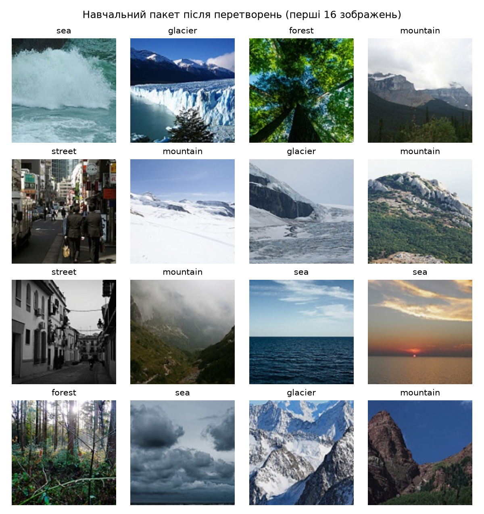
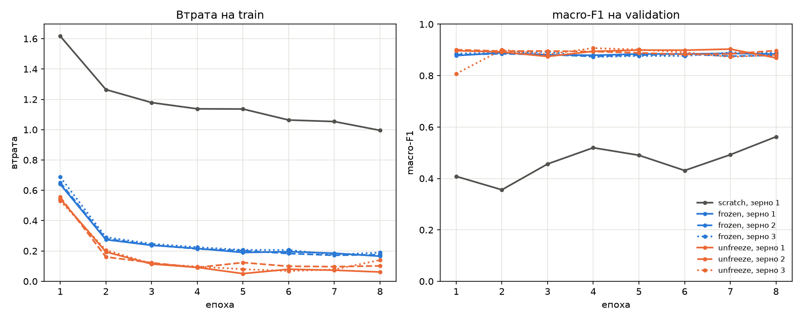
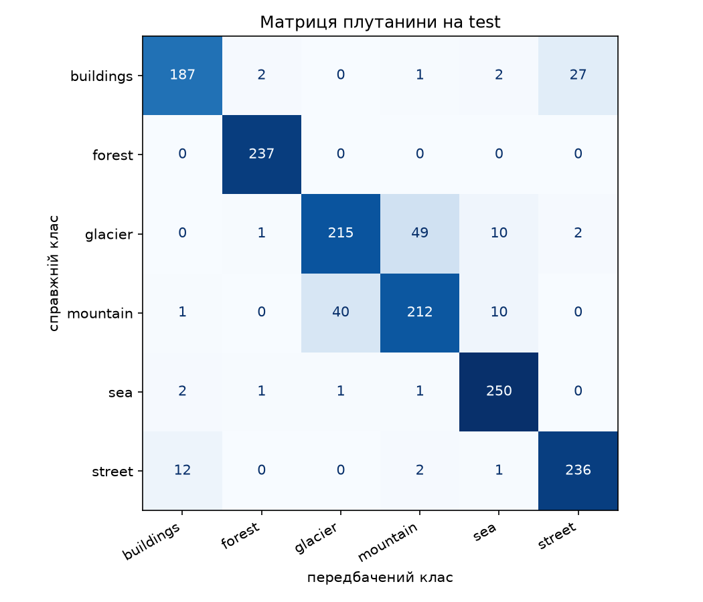
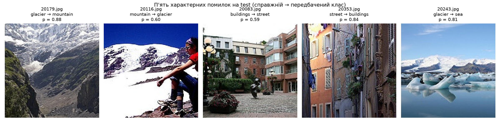

# ЛР3. Обчислювальний експеримент і трансферне навчання

Виконав: Медар Кирило, група КМ-31.

У роботі порівняно три режими навчання ResNet-18 на 1200 зображеннях набору Intel Image
Classification за однакового бюджету 304 кроки оптимізатора: scratch (уся мережа з випадкових
ваг), frozen (ваги ImageNet, навчається лише нова голова) і unfreeze (ваги ImageNet,
навчаються голова і стадія `layer4` з удесятеро меншою швидкістю). Перед експериментом
перевірено поділ, пакет після перетворень, початкову втрату, кількість параметрів і поведінку
кожного модуля за п'ять кроків. Виконано сім запусків, за validation обрано конфігурацію й один
раз оцінено її на test.

Результат: попереднє навчання дає Δpre = +0.3215 macro-F1 за порога шуму R = 0.0286;
розморожування `layer4` дає Δunf = −0.0013, що менше за R, тобто результату немає. Обрано
frozen, зерно 3; macro-F1 на test 0.8919.

## Запуск

Потрібні Python 3.12 та [uv](https://docs.astral.sh/uv/). Версії залежностей зафіксовано
в `pyproject.toml` і `uv.lock`. Команди виконуються з теки `lab3/`.

```bash
uv sync

# 1. Навчання: поділ і split.csv, перевірки пунктів 1-2, сім запусків, журнали, вибір,
#    lab3_model.pt. Test не завантажується. Тека --runs має бути порожньою: runs/ з
#    журналами звіту вже є в репозиторії, тому повторне навчання йде в іншу теку.
uv run python train.py --data /шлях/до/набору --runs runs_rerun --model lab3_model_rerun.pt --out outputs_rerun

# 2. Аналіз зі збережених журналів: перевірка хешу split.csv, таблиця, криві, ефекти,
#    перевірка вибору, потім один раз test на CPU, матриця плутанини, п'ять помилок.
uv run python analysis.py --data /шлях/до/набору
```

Окремо запускаються `data.py --data ...` (поділ і контрольна таблиця), `model.py` (параметри
трьох режимів) і `checks.py --data ...` (пункти 1-2).

Дані: [Intel Image Classification](https://www.kaggle.com/datasets/puneet6060/intel-image-classification).
Параметр `--data` вказує на теку, у якій лежать `seg_train/seg_train/<клас>/` і
`seg_test/seg_test/<клас>/` так, як вони розпаковуються з архіву Kaggle. Тека `seg_pred` не
використовується. Набір до репозиторію не додано.

## Склад теки

| Шлях | Зміст |
|---|---|
| `data.py` | поділ за процедурою умови, контрольна таблиця, `Dataset`, перетворення, завантажувачі |
| `model.py` | ResNet-18 у трьох режимах (кроки 1-5 умови), групи AdamW, `set_train_mode`, підрахунок параметрів |
| `checks.py` | пункти 1-2: рисунок пакета, L0, таблиця параметрів, що змінюється за 5 кроків, дослід із BN |
| `train.py` | команда навчання: поділ, перевірки, сім запусків, журнали, вибір, `lab3_model.pt` |
| `analysis.py` | команда аналізу: хеш поділу, таблиця, криві, ефекти, перевірка вибору, test |
| `split.csv` | поділ: `file`, `label`, `part`; 4200 рядків |
| `runs/<режим>_seed<зерно>/` | `run.json` і `val_logits.npy` (1498 × 6) для кожного з семи запусків; ваги окремих запусків `model.pt` лишаються локально |
| `lab3_model.pt` | ваги вибраного запуску (43 МБ): `state_dict`, `regime`, `seed`, `classes`, `img_size` |
| `outputs/train_batch.png`, `outputs/checks.md` | результати `checks.py` |
| `outputs/curves.png`, `outputs/runs_table.csv`, `outputs/effects.json` | сім запусків і розклад ефектів |
| `outputs/confusion_matrix.png`, `.csv`, `outputs/test_metrics.json` | тестова оцінка |
| `outputs/test_errors.png`, `.csv` | п'ять характерних помилок |
| `outputs/report.md` | усі таблиці пунктів 3-5, згенеровані `analysis.py`; числа цього README взято звідти |

## Відтворюваність

- **Середовище.** Windows, Python 3.12.8, PyTorch 2.14.1+cpu, torchvision 0.29.2+cpu,
  NumPy 2.5.3, pandas 3.0.6, scikit-learn 1.9.1. Навчання й тестова оцінка на CPU (AMD,
  6 потоків), float32. Навчальні фази семи запусків разом зайняли близько 19 хвилин, уся
  команда навчання з перевірками й оцінками на validation - близько 40 хвилин.
- **Версія коду.** Усі сім журналів записано на коміті `a07e7ff` без незакомічених змін у
  відстежуваних файлах (позначка `git_uncommitted_changes` перевіряє саме їх, нові файли на
  кшталт `runs/` не враховує). Пізніші коміти додали `analysis.py`, результати й цей звіт; код
  поділу, моделі, перевірок і циклу навчання після `a07e7ff` не змінювався.
- **Версія даних.** SHA-256 `split.csv`:
  `148dad92de9a18670c177df9f8757aa6519fb0ea6d74a8ba723cfc4453f0a1bc`, однаковий у семи
  журналах. `analysis.py` зупиняється, якщо хеш у журналах не збігається з поточним файлом.
  Файл записується з `\n` на будь-якій ОС, а `.gitattributes` забороняє git змінювати кінці
  рядків, інакше хеш на Windows і на Linux був би різним.
- **Що відтворюється точно.** Поділ (контрольна таблиця), кількості параметрів, відповіді
  «так/ні» перевірок пункту 2. На CPU повторний запуск `analysis.py` дає логіти validation,
  що збігаються зі збереженими в журналі з різницею 0. Значення macro-F1 після повторного
  навчання на іншій машині чи на GPU можуть відрізнятися.
- **Відхилення від умови.** Крім бібліотек стеку умови, використано pandas для `split.csv` і
  таблиць. Зображення відкриваються `Image.open(...).convert("RGB")`. Інших відхилень немає.

## Джерела та інструменти

- Умова роботи «ЛР3 завдання.pdf».
- Лекція 8 курсу: протокол налагодження (L0, пакет після перетворень), зерно й розмах, трекінг
  експериментів, трансферне навчання, заморожування і дискримінативні швидкості, пастка з
  пакетною нормалізацією. Лекція 7: будова і кількість параметрів ResNet-18. Лекція 5:
  режими train/eval пакетної нормалізації, поділ на train/validation/test.
- Документація PyTorch і torchvision: `resnet18`, `ResNet18_Weights`, `AdamW`,
  `BatchNorm2d`; scikit-learn: `f1_score`, `confusion_matrix`, `ConfusionMatrixDisplay`.
- Генеративний інструмент Claude (Anthropic): підготовка коду всіх п'яти модулів за
  описаними в умові процедурами, допомога з оформленням звіту. Запуски виконано на моїй
  машині, числа звіту взято з їхніх журналів.

## 1. Дані та перевірки до навчання

### Поділ

У `seg_train/seg_train` 14 034 зображення, у `seg_test/seg_test` 3000, шість класів у
фіксованому порядку buildings, forest, glacier, mountain, sea, street (індекси 0-5). Імена
файлів у кожному класі відсортовано як рядки. Для train один `np.random.default_rng(0)`
переставляє номери файлів класу за класом у фіксованому порядку, беруться перші 200.
Для validation і test новий `default_rng(0)` так само переставляє номери файлів `seg_test`:
перша половина (`idx[:n_k // 2]`) іде у validation, решта у test. Поділ збережено в
`split.csv`; далі дані читаються лише за ним.

| Клас | train | validation | test | Збіг |
|---|---|---|---|---|
| buildings | 200 / 1 996 761 | 218 / 4 837 323 | 219 / 4 837 559 | так |
| forest | 200 / 2 032 625 | 237 / 5 276 962 | 237 / 5 291 326 | так |
| glacier | 200 / 2 183 923 | 276 / 6 135 652 | 277 / 6 157 250 | так |
| mountain | 200 / 1 950 345 | 262 / 5 789 535 | 263 / 5 849 765 | так |
| sea | 200 / 1 987 613 | 255 / 5 655 068 | 255 / 5 668 011 | так |
| street | 200 / 1 841 817 | 250 / 5 541 845 | 251 / 5 547 533 | так |
| Разом | 1200 / 11 993 084 | 1498 / 33 236 385 | 1502 / 33 351 444 | |

Усі 18 клітинок збігаються з таблицею умови. Повторів імен у `split.csv` немає, тому жоден
файл не входить у дві частини. `train.py` не запускає навчання, якщо таблиця не збігається.

### Пакет після перетворень

Train: `RandomResizedCrop(160, scale=(0.7, 1.0))`, `RandomHorizontalFlip()`, `ToTensor()`,
`Normalize` зі статистиками ImageNet. Validation і test: `Resize((160, 160))`, `ToTensor()`,
те саме нормування. Статистики ImageNet використано і в scratch, щоб режими відрізнялися
лише ініціалізацією й тим, що навчається.



Перші 16 зображень навчального пакета після аугментацій з оберненим нормуванням
x · std + mean і міткою над кожним. Мітки відповідають зображенням, кольори природні,
кадрування різне.

### Початкова втрата

Моделі scratch і frozen побудовано зі зерном 1, після `set_train_mode` під `torch.no_grad()`
обчислено втрату на першому пакеті навчального завантажувача до жодного кроку:

| Режим | L0 | L0 − ln 6 |
|---|---|---|
| scratch | 2.0479 | +0.2561 |
| frozen | 1.9244 | +0.1326 |

ln 6 ≈ 1.7918 - втрата моделі, що дає всім класам однакову ймовірність. Обидва значення трохи
вищі. Причина в тому, що нова голова `Linear(512, 6)` ініціалізована випадково і її логіти не
нульові, тому розподіл на виході softmax нерівномірний. Поки передбачення не пов'язані з
мітками, сподівання втрати на прикладі дорівнює перехресній ентропії рівномірного розподілу
u відносно виходу q:

```math
H(u, q) = \ln 6 + D_{KL}(u \,\|\, q) \ge \ln 6,
```

з рівністю лише за рівномірного q. Відхилення на 0.13-0.26 невелике. Втрата, більша за ln 6
у кілька разів, означала б надто великі логіти (ненормований вхід, неправильний масштаб
ініціалізації); втрата, менша за ln 6, - привід шукати мітку у вході. Ні того, ні іншого немає.

## 2. Перевірка режимів навчання

### Параметри

| Режим | Усього | requires_grad=True | Групи AdamW (параметрів, швидкість навчання) | Збіг |
|---|---|---|---|---|
| scratch | 11 179 590 | 11 179 590 | 11 179 590 при 3e-3 | так |
| frozen | 11 179 590 | 3 078 | 3 078 при 3e-3 | так |
| unfreeze | 11 179 590 | 8 396 806 | 3 078 при 3e-3; 8 393 728 при 3e-4 | так |

Кількості - суми `numel()`. Голова `Linear(512, 6)` має 512 · 6 + 6 = 3078 параметрів,
стадія `layer4` - 8 393 728 (таблиця параметрів ResNet-18 з лекції 7), разом 8 396 806.
Оптимізатор у `build_model` збирається лише з параметрів модулів, що навчаються;
`parameter_summary` додатково перевіряє, що в ньому немає жодного параметра з
`requires_grad=False` і що сума параметрів груп дорівнює кількості параметрів із
`requires_grad=True`. AdamW з `weight_decay=1e-4` в усіх групах, решта аргументів за
замовчуванням.

### Що змінюється під час навчання

Для frozen і unfreeze збережено копію повного `state_dict()` (параметри й буфери),
викликано `set_train_mode`, виконано 5 кроків на перших 5 пакетах. Порівняння точне,
`torch.equal`.

| Режим | Модуль | Параметри змінилися | Ковзні статистики BN змінилися | Збігається з очікуваним |
|---|---|---|---|---|
| frozen | `conv1` | ні | немає BN | так |
| frozen | `bn1` | ні | ні | так |
| frozen | `layer1` | ні | ні | так |
| frozen | `layer2` | ні | ні | так |
| frozen | `layer3` | ні | ні | так |
| frozen | `layer4` | ні | ні | так |
| frozen | `fc` | так | немає BN | так |
| unfreeze | `conv1` | ні | немає BN | так |
| unfreeze | `bn1` | ні | ні | так |
| unfreeze | `layer1` | ні | ні | так |
| unfreeze | `layer2` | ні | ні | так |
| unfreeze | `layer3` | ні | ні | так |
| unfreeze | `layer4` | так | так | так |
| unfreeze | `fc` | так | немає BN | так |

Усі 14 рядків збігаються з очікуваним: заморожені модулі не змінилися ні за параметрами, ні
за статистиками; `fc` змінилася за параметрами; `layer4` в unfreeze - і за параметрами, і за
статистиками BN.

### Дослід із навмисною помилкою

**Прогноз.** Якщо у frozen замість `set_train_mode` викликати `model.train()`, параметри
кістяка (ваги згорток, γ і β пакетної нормалізації) не зміняться: їх немає в оптимізаторі, і
градієнт для них не обчислюється. Зміняться ковзні статистики `running_mean` і `running_var`
в усіх шарах BN кістяка, бо в режимі `train()` BN перезаписує їх у прямому проході за
статистиками поточного пакета незалежно від `requires_grad`. З кривої втрати на train цього
не було б видно: у режимі `train()` BN нормує вхід за статистиками пакета, а не за ковзними,
тому на втраті під час навчання їхній дрейф не позначається; він проявиться лише на
validation і test, де модель переходить у `eval()`.

**Результат.**

| Режим | Модуль | Параметри змінилися | Ковзні статистики BN змінилися | Збігається з очікуваним |
|---|---|---|---|---|
| frozen | `conv1` | ні | немає BN | так |
| frozen | `bn1` | ні | так | ні |
| frozen | `layer1` | ні | так | ні |
| frozen | `layer2` | ні | так | ні |
| frozen | `layer3` | ні | так | ні |
| frozen | `layer4` | ні | так | ні |
| frozen | `fc` | так | немає BN | так |

Максимальна абсолютна зміна в `layer1.0.bn1` після 5 кроків: `running_mean` 0.0928,
`running_var` 0.1203. Прогноз підтвердився: параметри кістяка на місці, статистики
змінилися в усіх п'яти модулях із BN.

**Чому `requires_grad=False` не захищає ці значення.** `running_mean` і `running_var` -
буфери, а не параметри. Прапорець `requires_grad` стосується лише обчислення градієнта,
оптимізатор до буферів не причетний. Оновлення робить сам шар у прямому проході:

```math
\hat\mu \leftarrow (1 - m)\,\hat\mu + m\,\mu_B,\qquad m = 0.1.
```

За 5 кроків від статистик ImageNet лишається частка 0.9^5 ≈ 0.59, за 304 кроки - 0.9^304,
тобто практично нічого. Ваги згорток ті самі, а нормування після них інше, отже, інші й
ознаки, на яких навчилася голова; лекція 8 називає це пасткою BN, і орієнтир «frozen нижче
0.80» в умові стосується саме її.

**Чому для `layer4` в unfreeze оновлення правильне.** Згортки `layer4` навчаються, їхні
виходи змінюють середнє й дисперсію, і BN має нормувати їх за статистиками, що відповідають
поточним вагам і цільовим даним. Статистики ImageNet описують виходи вже інших згорток.

## 3. Сім запусків

Кожен запуск будує модель за кроками 1-5 умови. Train-завантажувач: `batch_size=32`,
`shuffle=True` без власного генератора (випадковість із глобального генератора PyTorch,
засіяного на кроці 1), `drop_last=False`, `num_workers=0`. Бюджет: 8 епох по 38 кроків,
304 кроки, останній пакет епохи з 16 зображень. На початку епохи `set_train_mode`, після
епохи - `model.eval()`, логіти validation і macro-F1. Втрата епохи - Σ L_b |b| / 1200,
де L_b - втрата пакета до кроку оптимізатора. Розкладів, ранньої зупинки, вибору епохи немає;
використано ваги після 8-ї епохи.

Журнал `runs/<режим>_seed<зерно>/run.json` містить зерно, перетворення, модель, групи
оптимізатора з усіма аргументами AdamW, параметри BN, завантажувачі й бюджет, хеш коміту й
позначку незакомічених змін, SHA-256 `split.csv`, версії Python, PyTorch, torchvision,
NumPy, пристрій, втрату на train і macro-F1 на validation за кожну епоху, час навчання.
Поруч - `val_logits.npy` після 8-ї епохи у порядку рядків validation у `split.csv`.

| # | Режим | Зерно | Втрата train, епоха 8 | macro-F1 validation, епоха 8 | Час навчання, с |
|---|---|---|---|---|---|
| 1 | scratch | 1 | 0.9954 | 0.5622 | 333.8 |
| 2 | frozen | 1 | 0.1655 | 0.8842 | 111.8 |
| 3 | frozen | 2 | 0.1757 | 0.8785 | 111.0 |
| 4 | frozen | 3 | 0.1896 | 0.8886 | 110.6 |
| 5 | unfreeze | 1 | 0.0614 | 0.8690 | 157.6 |
| 6 | unfreeze | 2 | 0.1014 | 0.8976 | 161.9 |
| 7 | unfreeze | 3 | 0.1402 | 0.8808 | 161.0 |

Час навчання - сума тривалостей навчальних фаз восьми епох без оцінки на validation.



Frozen дає близько 0.88, як орієнтир умови. Frozen і unfreeze з другої епохи лежать у смузі
0.87-0.91 і далі коливаються в ній, їхні криві перетинаються. Unfreeze має
помітно меншу втрату на train (0.06-0.14 проти 0.17-0.19), але не кращий macro-F1 на
validation: додаткові 8.4 млн параметрів підганяються під 1200 зображень. Scratch за 304
кроки зменшив втрату з 1.62 до 1.00 і крива ще спадає; його macro-F1 на validation росте з
коливаннями від 0.36 до 0.56.

## 4. Розклад ефектів

Для frozen і unfreeze - середнє й розмах за трьома зернами, поріг шуму - більший із двох
розмахів:

```math
\bar F_r = \frac{1}{3}\sum_{s=1}^{3} F_{r,s},\qquad
R_r = \max_s F_{r,s} - \min_s F_{r,s},\qquad
R = \max(R_{\mathrm{frozen}}, R_{\mathrm{unfreeze}}).
```

Ефект попереднього навчання та ефект розморожування:

```math
\Delta_{\mathrm{pre}} = \bar F_{\mathrm{frozen}} - F_{\mathrm{scratch},1},\qquad
\Delta_{\mathrm{unf}} = \bar F_{\mathrm{unfreeze}} - \bar F_{\mathrm{frozen}},\qquad
\Delta_{\mathrm{pre}} + \Delta_{\mathrm{unf}} = \bar F_{\mathrm{unfreeze}} - F_{\mathrm{scratch},1}.
```

| Величина | Значення |
|---|---|
| F_scratch,1 | 0.5622 |
| F̄_frozen, R_frozen | 0.8838, 0.0101 |
| F̄_unfreeze, R_unfreeze | 0.8824, 0.0286 |
| R | 0.0286 |
| Δpre | +0.3215 |
| Δunf | −0.0013 |
| Δpre + Δunf | +0.3202 |

Правило застосовано до кожного ефекту окремо. Δpre: |Δ| > R (в 11 разів), ефект вартий
перевірки, але не доведений. Δunf: |Δ| ≤ R (у 22 рази менший), різниця не відрізняється
від розкиду, результату немає. Розмах трьох значень - груба й консервативна оцінка шуму,
а не довірчий інтервал: він вимагає від ефекту приблизно двох стандартних похибок різниці
середніх, але сам за трьома значеннями дуже неточний.

**Що змінює зерно.** У scratch зерно визначає початкові ваги всіх 11.2 млн параметрів,
порядок пакетів і параметри аугментацій (кадрування, віддзеркалення). У frozen і unfreeze
кістяк завжди стартує з тих самих ваг ImageNet, тому зерно впливає лише на початкову голову
(3078 чисел), порядок пакетів і аугментації. У frozen кістяк у `eval()` для одного й того
самого кадру щоразу дає ті самі 512 ознак, і задача зводиться до лінійного класифікатора на
фіксованих ознаках; різні зерна сходяться до близьких розв'язків, R_frozen = 0.0101. В
unfreeze разом із головою рухаються 8.4 млн параметрів `layer4`, і їхня траєкторія залежить
від порядку пакетів: криві unfreeze коливаються сильніше (зерно 1 упало з 0.9032 на 7-й
епосі до 0.8690 на 8-й, зерно 3 стартувало з 0.8074), R_unfreeze = 0.0286, у 2.8 раза
більше.

**Чому R не характеризує запуск 1.** R виміряно на запусках 2-7, де випадковість стосується
лише голови, порядку пакетів і аугментацій. У scratch зерно задає всю мережу, тож джерело
шуму інше й більше, а за одним запуском розкид оцінити не можна. Крива запуску 1 це
підтверджує: за вісім епох macro-F1 ходив від 0.3559 до 0.5622, між сусідніми епохами
змінювався до 0.10, тоді як R = 0.0286. Значення F_scratch,1 = 0.5622 - це найвища
точка нестабільної кривої; інше зерно чи інша епоха дали б число, що відрізняється на кілька
сотих, а то й на десяту. На висновок щодо Δpre це не впливає: Δpre = 0.32 у кілька разів
більше за будь-яке з цих коливань, і навіть якби scratch отримав верхню межу своєї кривої,
відставання від F̄_frozen лишилося б понад 0.3.

**Чи однаковий бюджет за часом.** Ні. Кроків в усіх режимах 304, а час різний: scratch
333.8 с, frozen 110.6-111.8 с, unfreeze 157.6-161.9 с. У frozen зворотний прохід
обмежений головою, і час іде на декодування зображень і прямий прохід. Unfreeze додає
зворотний прохід через `layer4` і оновлення 8.4 млн параметрів, це +45 % часу. Scratch
рахує градієнти по всій мережі й утричі довший за frozen. Однаковий бюджет у цій роботі -
однакова кількість кроків, а не однаковий час; за той самий час frozen міг би зробити
втричі більше кроків, ніж scratch.

## 5. Вибір конфігурації і тестова оцінка

Вибір зроблено в `train.py` лише за validation: режим із найбільшим F̄_r, у ньому запуск із
найбільшим F_r,s. Найбільше середнє у frozen (0.8838 проти 0.8824 в unfreeze і 0.5622 у
scratch), найкращий запуск у ньому - зерно 3 з F = 0.8886. Ваги збережено в `lab3_model.pt`
з `regime="frozen"`, `seed=3`, списком класів у фіксованому порядку та `img_size=160`.

Оскільки |Δunf| ≤ R, вибір між frozen і unfreeze визначив шум: різниця середніх 0.0013 менша
за розкид будь-якого з режимів. Процедура від цього не змінюється.

`analysis.py` перевіряє вибір за збереженими журналами (правило дає frozen, зерно 3, що
збігається з `lab3_model.pt`) і звіряє логіти validation цієї моделі на CPU зі збереженими в
журналі: різниця 0, бо навчання теж виконано на CPU.

### Тестова оцінка

Test (1502 зображення) використано один раз, в `analysis.py`, на CPU.

| Величина | Значення |
|---|---|
| macro-F1 на test | 0.8919 |
| F_r,s вибраного запуску на validation | 0.8886 |
| test − validation | +0.0033 |
| accuracy на test, p | 0.8901 |
| √(p(1 − p)/n), n = 1502 | 0.0081 |

Матриця плутанини (рядки - справжній клас, стовпці - передбачений):

| справжній \ передбачений | buildings | forest | glacier | mountain | sea | street |
|---|---|---|---|---|---|---|
| buildings | **187** | 2 | 0 | 1 | 2 | 27 |
| forest | 0 | **237** | 0 | 0 | 0 | 0 |
| glacier | 0 | 1 | **215** | 49 | 10 | 2 |
| mountain | 1 | 0 | 40 | **212** | 10 | 0 |
| sea | 2 | 1 | 1 | 1 | **250** | 0 |
| street | 12 | 0 | 0 | 2 | 1 | **236** |



Помилок 165 із 1502. Пара glacier ↔ mountain дає 89 (49 + 40), пара buildings ↔ street -
39 (27 + 12); разом 128, тобто 78 % усіх помилок. Ще 20 помилок - glacier і mountain,
передбачені як sea. Forest розпізнано без жодної помилки.

**Зміщення від вибору.** Вибраний запуск має найбільше F_r,s серед трьох, тому його
валідаційне число оптимістично зміщене: 0.8886 проти середнього режиму 0.8838. У числах
зміщення не видно: macro-F1 на test навіть вищий за validation на 0.0033. Стандартна похибка
частки правильних відповідей на test дорівнює √(0.8901 · 0.1099 / 1502) ≈ 0.0081, така сама
за порядком і у validation, тож різниця двох оцінок має шум близько 0.0081 · √2 ≈ 0.011.
Очікуване зміщення від вибору найкращого з трьох близьких запусків (різниця з середнім
0.005) менше за цей шум, тому його може бути не видно, а випадкова різниця між двома
половинами `seg_test` може дати й протилежний знак, як тут.

### П'ять характерних помилок

П'ять найчастіших позадіагональних пар (за однакової кількості - за зростанням індексу
справжнього, потім передбаченого класу: пари glacier → sea і mountain → sea мають по 10,
узято glacier → sea), для кожної - перший за іменем файл test із такою помилкою.
Імовірність - softmax логітів test для передбаченого класу.

| Файл | Справжній клас | Передбачений клас | Імовірність передбаченого класу | Кількість таких помилок у test |
|---|---|---|---|---|
| 20179.jpg | glacier | mountain | 0.8772 | 49 |
| 20116.jpg | mountain | glacier | 0.6007 | 40 |
| 20083.jpg | buildings | street | 0.5938 | 27 |
| 20353.jpg | street | buildings | 0.8439 | 12 |
| 20243.jpg | glacier | sea | 0.8065 | 10 |



- **20179.jpg** (glacier → mountain): сцена містить обидва класи - гірська ущелина зі
  скелями й лісом займає більшу частину кадру, лід видно лише на схилах угорі.
- **20116.jpg** (mountain → glacier): сцена містить обидва класи - засніжений схил гори на
  передньому плані виглядає як льодовик, модель вагалася (p = 0.60).
- **20083.jpg** (buildings → street): сцена містить обидва класи - фасади навколо
  брукованого двору з ліхтарем і клумбами.
- **20353.jpg** (street → buildings): сцена містить обидва класи - вузька вулиця, у кадрі
  майже лише фасади.
- **20243.jpg** (glacier → sea): сцена містить обидва класи - брили льоду плавають у воді,
  яка займає половину кадру.

Плутанина glacier ↔ mountain - властивість набору: на багатьох знімках є і гора, і лід, і
мітка залежить від того, що анотатор вважав головним. «Виправляти» її моделлю не треба.
Те саме, меншою мірою, стосується пари buildings ↔ street: вулиця без будинків у наборі
рідкість.

## 6. Висновок

**Ефект попереднього навчання.** Напрям додатний: F̄_frozen = 0.8838 проти
F_scratch,1 = 0.5622. Величина Δpre = +0.3215, тобто 32 пункти macro-F1. Це в 11 разів
більше за поріг шуму R = 0.0286, а також значно більше за розмах кривої самого scratch
(0.36-0.56), тому за правилом роботи ефект вартий перевірки, але не доведений; практично
сумнівів у його напрямі немає. Ефект виміряно за бюджету 304 кроки: втрата scratch на train
ще спадала (1.62 → 1.00), і з довшим навчанням scratch міг би скоротити відставання.

**Ефект розморожування.** Напрям від'ємний, але мізерний: F̄_unfreeze = 0.8824 проти
F̄_frozen = 0.8838, Δunf = −0.0013, тобто 0.1 пункта macro-F1. Це у 22 рази менше за
R = 0.0286 і менше за розмах кожного з режимів, тож різниця не відрізняється від розкиду і
результату немає. Увесь виграш трансферу Δpre + Δunf = +0.3202 дають попередньо навчені
ознаки; донавчання `layer4` за 304 кроки з 200 зображеннями на клас нічого не додало, хоча
помітно зменшило втрату на train (0.06-0.14 проти 0.17-0.19). Цей ефект теж виміряно за бюджету 304 кроки.

Для нової задачі з 200 зображеннями на клас я взяв би режим frozen: та сама якість у межах
шуму, розкид між зернами майже втричі менший (0.0101 проти 0.0286), навчання на 30 %
швидше за unfreeze і втричі швидше за scratch.


Використання ШІ - claude для допомоги в оформленні звіту
