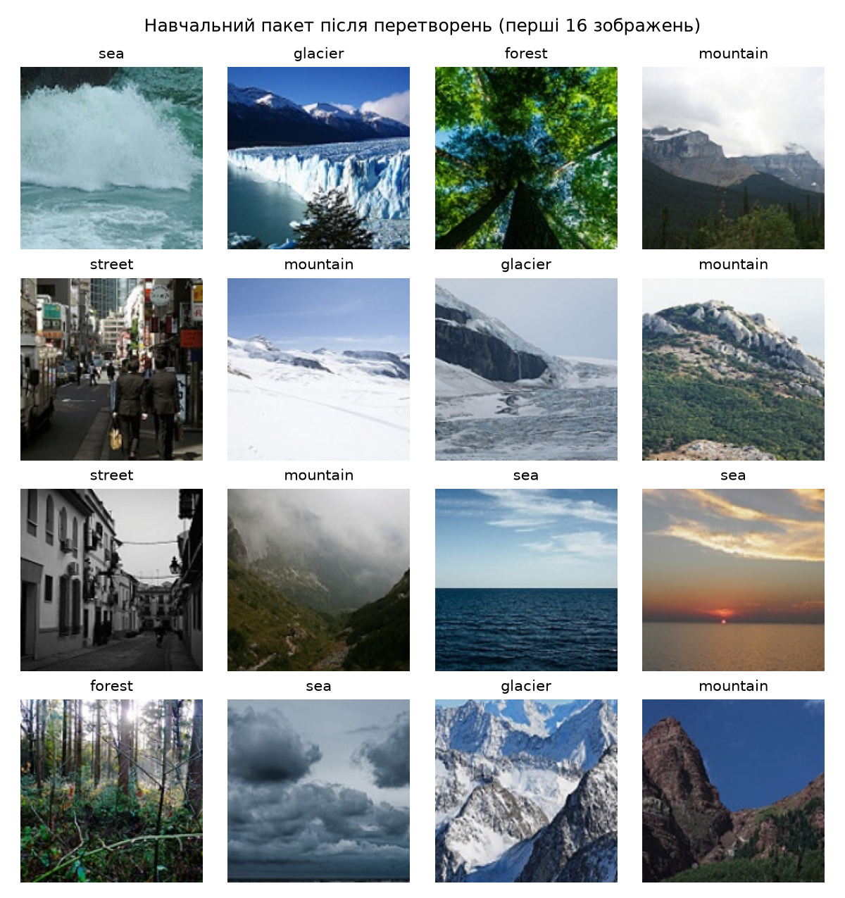

# Перевірки до навчання (пункти 1-2)

Пристрій: `cpu`, зерно 1.

## Пакет після перетворень

## Початкова втрата

ln 6 = 1.7918

| Режим | L0 | L0 - ln 6 |
|---|---|---|
| scratch | 2.0479 | +0.2561 |
| frozen | 1.9244 | +0.1326 |

## Параметри та групи оптимізатора

| Режим | Усього параметрів | requires_grad=True | Групи AdamW (параметрів, швидкість) | Збіг |
|---|---|---|---|---|
| scratch | 11 179 590 | 11 179 590 | 11 179 590 при 0.003 | так |
| frozen | 11 179 590 | 3 078 | 3 078 при 0.003 | так |
| unfreeze | 11 179 590 | 8 396 806 | 3 078 при 0.003; 8 393 728 при 0.0003 | так |

## Що змінюється за 5 кроків із set_train_mode

| Режим | Модуль | Параметри змінилися | Ковзні статистики BN змінилися | Збігається з очікуваним |
|---|---|---|---|---|
| frozen | `conv1` | ні | немає BN | так |
| frozen | `bn1` | ні | ні | так |
| frozen | `layer1` | ні | ні | так |
| frozen | `layer2` | ні | ні | так |
| frozen | `layer3` | ні | ні | так |
| frozen | `layer4` | ні | ні | так |
| frozen | `fc` | так | немає BN | так |
| unfreeze | `conv1` | ні | немає BN | так |
| unfreeze | `bn1` | ні | ні | так |
| unfreeze | `layer1` | ні | ні | так |
| unfreeze | `layer2` | ні | ні | так |
| unfreeze | `layer3` | ні | ні | так |
| unfreeze | `layer4` | так | так | так |
| unfreeze | `fc` | так | немає BN | так |

## Дослід із навмисною помилкою: frozen із model.train()

| Режим | Модуль | Параметри змінилися | Ковзні статистики BN змінилися | Збігається з очікуваним |
|---|---|---|---|---|
| frozen | `conv1` | ні | немає BN | так |
| frozen | `bn1` | ні | так | ні |
| frozen | `layer1` | ні | так | ні |
| frozen | `layer2` | ні | так | ні |
| frozen | `layer3` | ні | так | ні |
| frozen | `layer4` | ні | так | ні |
| frozen | `fc` | так | немає BN | так |

Максимальна абсолютна зміна в `layer1.0.bn1` після 5 кроків: running_mean 0.092836, running_var 0.120314.

Усі перевірки збіглися з очікуваним: так
