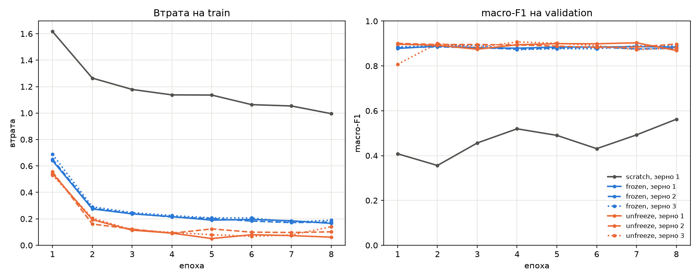
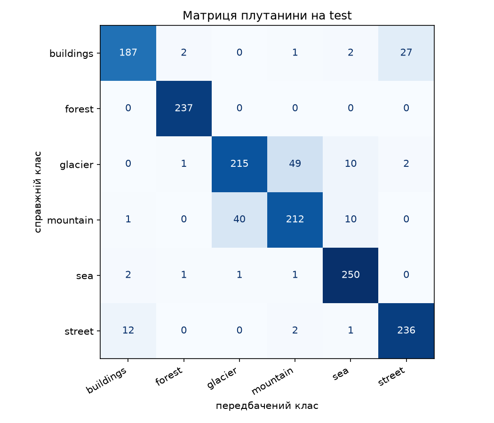
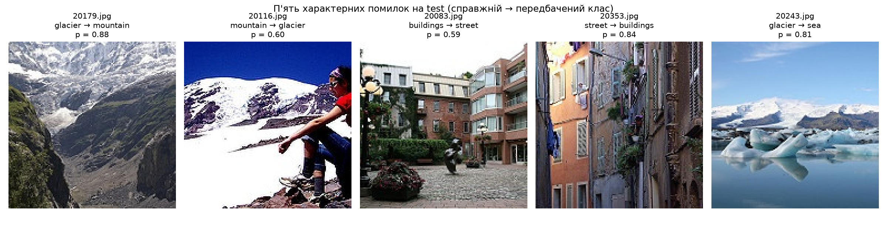

# Результати аналізу (пункти 3-5)

## Сім запусків

SHA-256 `split.csv` однаковий у семи журналах і збігається з поточним файлом: `148dad92de9a18670c177df9f8757aa6519fb0ea6d74a8ba723cfc4453f0a1bc`.
Коміт коду (незакомічені зміни): `a07e7ff0852b3df7b4f734760b7a682b2684e13d` (False).
Python 3.12.8, PyTorch 2.14.1+cpu, torchvision 0.29.2+cpu, пристрій `cpu` (AMD64 Family 23 Model 104 Stepping 1, AuthenticAMD), потоків 6.

| # | Режим | Зерно | Втрата train, епоха 8 | macro-F1 validation, епоха 8 | Час навчання, с |
|---|---|---|---|---|---|
| 1 | scratch | 1 | 0.9954 | 0.5622 | 333.8 |
| 2 | frozen | 1 | 0.1655 | 0.8842 | 111.8 |
| 3 | frozen | 2 | 0.1757 | 0.8785 | 111.0 |
| 4 | frozen | 3 | 0.1896 | 0.8886 | 110.6 |
| 5 | unfreeze | 1 | 0.0614 | 0.8690 | 157.6 |
| 6 | unfreeze | 2 | 0.1014 | 0.8976 | 161.9 |
| 7 | unfreeze | 3 | 0.1402 | 0.8808 | 161.0 |

## Розклад ефектів

| Величина | Значення |
|---|---|
| F_scratch,1 | 0.5622 |
| F̄_frozen, R_frozen | 0.8838, 0.0101 |
| F̄_unfreeze, R_unfreeze | 0.8824, 0.0286 |
| R = max(R_frozen, R_unfreeze) | 0.0286 |
| Δpre = F̄_frozen − F_scratch,1 | +0.3215 |
| Δunf = F̄_unfreeze − F̄_frozen | -0.0013 |
| Δpre + Δunf | +0.3202 |

Δpre: |Δ| > R: ефект вартий перевірки, але не доведений.
Δunf: |Δ| ≤ R: різниця не відрізняється від розкиду, результату немає.

## Перевірка вибору

Правило вибору за журналами: frozen, зерно 3. У `lab3_model.pt`: frozen, зерно 3, класи ['buildings', 'forest', 'glacier', 'mountain', 'sea', 'street'], img_size 160.
Найбільша різниця між логітами validation цієї моделі на CPU і збереженими в журналі: 0.00e+00.
|Δunf| ≤ R, тому вибір між frozen і unfreeze визначив шум.

## Тестова оцінка (один раз, CPU)

| Величина | Значення |
|---|---|
| macro-F1 на test | 0.8919 |
| F_r,s вибраного запуску на validation | 0.8886 |
| test − validation | +0.0033 |
| accuracy на test, p | 0.8901 |
| √(p(1−p)/n), n = 1502 | 0.0081 |

### Матриця плутанини

| справжній \ передбачений | buildings | forest | glacier | mountain | sea | street |
|---|---|---|---|---|---|---|
| buildings | 187 | 2 | 0 | 1 | 2 | 27 |
| forest | 0 | 237 | 0 | 0 | 0 | 0 |
| glacier | 0 | 1 | 215 | 49 | 10 | 2 |
| mountain | 1 | 0 | 40 | 212 | 10 | 0 |
| sea | 2 | 1 | 1 | 1 | 250 | 0 |
| street | 12 | 0 | 0 | 2 | 1 | 236 |

### П'ять характерних помилок

| Файл | Справжній клас | Передбачений клас | Імовірність передбаченого класу | Кількість таких помилок у test |
|---|---|---|---|---|
| 20179.jpg | glacier | mountain | 0.8772 | 49 |
| 20116.jpg | mountain | glacier | 0.6007 | 40 |
| 20083.jpg | buildings | street | 0.5938 | 27 |
| 20353.jpg | street | buildings | 0.8439 | 12 |
| 20243.jpg | glacier | sea | 0.8065 | 10 |

